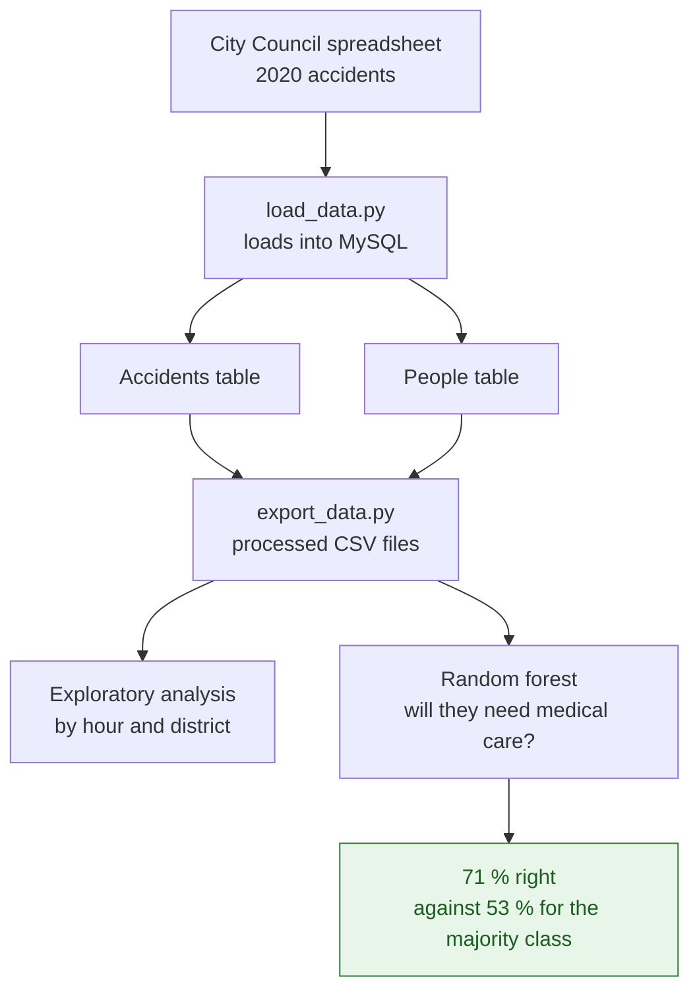

Versión en español: [README.md](README.md)

# Road accidents in Madrid in 2020

It takes Madrid City Council's open road-accident data from a spreadsheet into a database, analyses it by hour and
district, and trains a model that estimates whether a person involved will need medical assistance.

**Result:** 12,634 accidents with 28,773 people involved. The busiest hour is 14:00. The model is right in 71 % of
cases, against 53 % for always giving the most frequent answer.

```bash
pip install -r requirements.txt
jupyter notebook notebooks/01_eda_exploratorio.ipynb
jupyter notebook notebooks/02_modelo_predictivo_gravedad.ipynb
```

Both notebooks read the CSV files in `data/processed/` and run without a database.

## The starting problem

The Council's spreadsheet has one row per person involved, not per accident: a crash between two cars with one
passenger takes three rows. Counting rows gives 28,773 "accidents" and moves the peak hour to the evening. The
loader groups by case number, which is what identifies an accident, and the count is 12,634.

## What is inside




1. `scripts/load_data.py` loads the Excel file into MySQL, one accident per case number and the people apart.
2. `scripts/export_data.py` exports both tables to `data/processed/`.
3. `notebooks/01_eda_exploratorio.ipynb` analyses accidents by hour and district and the injury outcome of each
   person.
4. `notebooks/02_modelo_predictivo_gravedad.ipynb` trains a random forest on hour, age, district, accident type,
   weather and vehicle.

## What comes out

- The busiest hour is 14:00, with 892 accidents; the quietest is 04:00, with 90.
- Salamanca is the district with most accidents, 965.
- Of the people with an injury code recorded, most needed no medical assistance; serious injuries and deaths add up
  to 399 of 28,773.
- In the model, vehicle type carries the most weight.

## What the model predicts

The injury codes follow the Council's official data structure: codes 1 to 7 mean there was medical assistance (3 is
serious and 4 is death) and 14 means no medical assistance. The model separates those who needed assistance from
those who did not. Serious injuries and deaths are too few for a model of their own.

## Limits

- Close to half of the people involved have no injury code in the source data, and they are left out of the model.
- Age comes in five-year bands; the model uses the midpoint of each band.
- A 71 % hit rate is good for ranking cases by probability, not for deciding case by case.
- Reloading the database needs MySQL: `sql/schema.sql` creates the tables and `.env.example` is the connection
  template.

## Data

`data/raw/2020_Accidentalidad.xlsx` comes from Madrid City Council's open data portal. The CSV files in
`data/processed/` are produced from it by the scripts in this repository.

## Related repositories

- [lead-scoring-ml](https://github.com/jleonceo/lead-scoring-ml): ranking sales contacts by their probability of
  buying.
- [RFM-Customer-Analytics](https://github.com/jleonceo/RFM-Customer-Analytics): customer segmentation by recency,
  frequency and monetary value.
- [de-datos-en-bruto-a-decisiones](https://github.com/jleonceo/de-datos-en-bruto-a-decisiones): a raw sales file
  turned into business answers and a dashboard.

---

*Part of [Juan Luis León](https://github.com/jleonceo)'s portfolio · [juanluisleon.vercel.app](https://juanluisleon.vercel.app) · Licence [MIT](LICENSE)*
